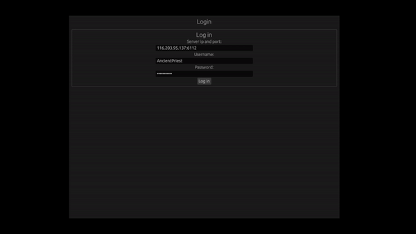
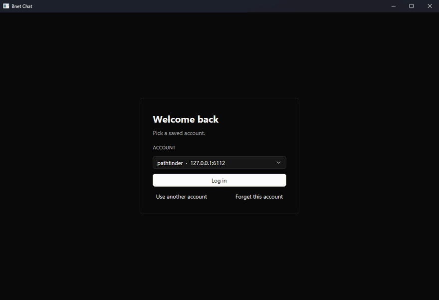

# pvpgn-chat

This is a test project in Rust programming language to connect to a pvpgn server and receive packages.

[W3 Developers discord](https://discord.gg/jq6rPHc95D)

## To test

** Observation: `Server` needs to be ip+port
`116.203.95.137:6112`

#### `cargo run`

#### GPUI prototype: `cargo run -p bnetchat-gpui`

A second front end built on [GPUI](https://www.gpui.rs/) (Zed's UI framework) with
[gpui-kit](https://crates.io/crates/gpui-kit) components. Both apps share the
protocol, session and chat state in `src/lib.rs`; only the UI differs.

Saved accounts keep their passwords in the OS credential store (Windows Credential
Manager, macOS Keychain, Linux keyring); `accounts.json` only lists server and username.

- [x] Fixed scrolling
- [x] Added unsafe to char reading from tcpstream
- [x] Right click on user

## Not yet there
~~* Submit on enter on message input~~
~~* Styles~~
* Icons
~~* Code beautify~~
* Message styles in main panel
~~* A lot of error handling~~
* ...

It's full of bugs, but it's a working POC.
